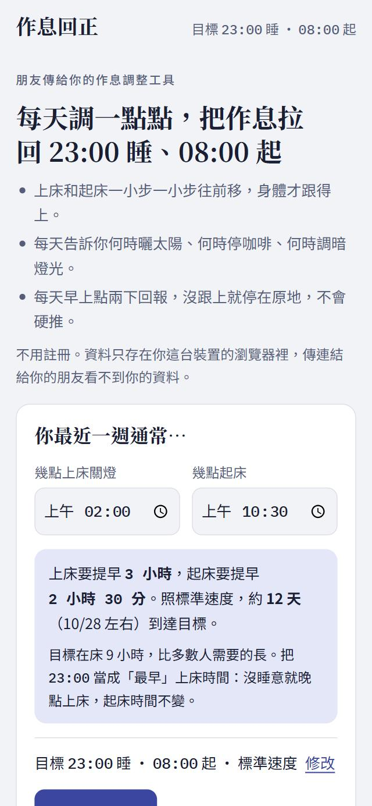
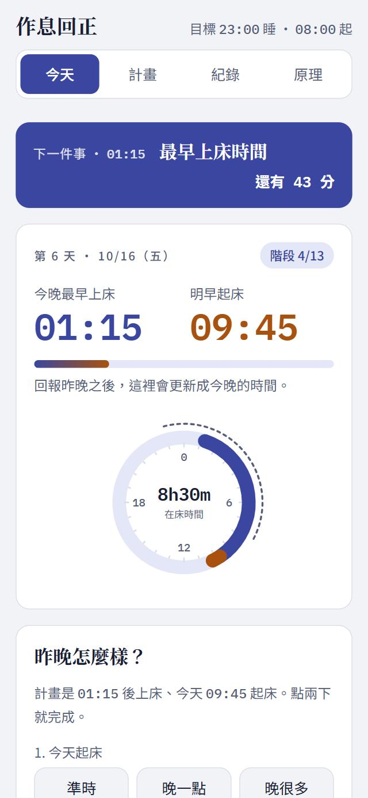
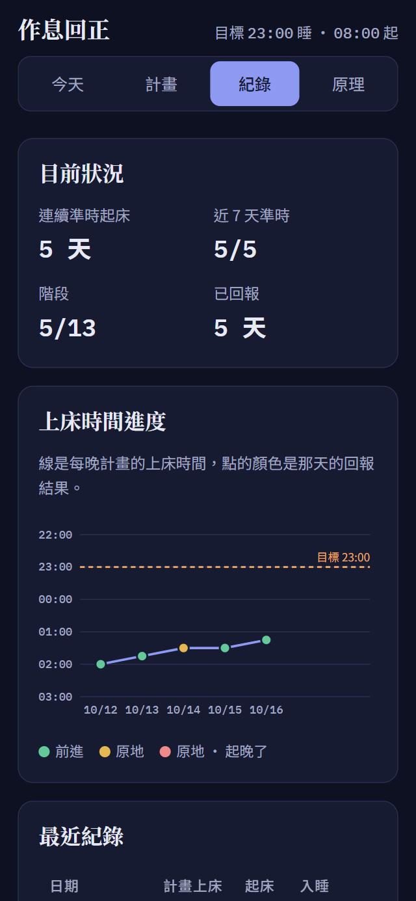

# 作息回正 · Good Night Sleep Tight

[English](README.md) · **繁體中文** · [日本語](README.ja.md) · [한국어](README.ko.md)

> 每天調一點點，把作息拉回 **23:00 睡、08:00 起**。

作息回正是一個小小的網頁 app，寫給生理時鐘已經往後飄的人：凌晨 2 點才睡得著、10 點半才起得來，叫自己「早點睡」也沒用。它不要求你一次跳到目標，而是把上床和起床時間每次提早 15 分鐘，等身體真的跟上了才往前走。

不用註冊，沒有伺服器。整個 app 就是一個 HTML 檔，資料只存在你自己的手機裡。

  
  
  

## 立即使用

- **線上版：** https://claude.ai/artifact/N1Yr1VDgdJAJEbv1AX2Hi7 （建議用手機打開，任何拿到連結的人都能用）
- **GitHub Pages：** 這個 repo 開啟 Pages 之後，網址會是 https://f64081169.github.io/GoodNightSleepTight/
- **離線使用：** 下載 `index.html`，用任何瀏覽器打開就能用。

## 為什麼要慢慢調？

生理時鐘一天只能穩定地撥動 15–30 分鐘。一次提早三小時，身體的反應跟時差一樣：躺在床上睡不著，越來越挫折，最後放棄。這個 app 依照處理「作息延後」的標準行為治療原則設計：

| 原則 | App 怎麼做 |
|---|---|
| **漸進式提前** | 上床、起床一次只提早一小步，跟上了才往前。 |
| **起床是錨點** | 就算前一晚沒睡好也照時間起床，當天晚上自然會比較早想睡。 |
| **上床時間是「最早」時間** | 有睡意才上床。長時間醒著躺在床上，反而會養成失眠。 |
| **早上曬太陽** | 起床後到戶外 20–30 分鐘，這是把時鐘往前撥最強的訊號。 |
| **晚上調暗燈光** | 睡前 2 小時調暗燈光，睡前 45 分鐘放下手機。 |
| **咖啡因與小睡截止** | 睡前 8 小時內不喝含咖啡因飲料、不小睡；小睡最多 20 分鐘。 |
| **刺激控制（CBT-I）** | 躺 20 分鐘睡不著就起床，到昏暗的地方做無聊的事，有睡意再回床上。 |

### 什麼時候會往前一步？

每天早上點兩下，回答兩個問題：

| 今天起床 | 30 分內睡著 | 躺超過 30 分 | 比較晚上床 |
|---|---|---|---|
| **準時**（前後 15 分內） | ✅ 前進一步 | ⏸ 原地 | ⏸ 原地 |
| **晚 15–30 分** | ⏸ 原地 | ⏸ 原地 | ⏸ 原地 |
| **晚超過 30 分** | ⏸ 原地 · 起晚了 | ⏸ 原地 · 起晚了 | ⏸ 原地 · 起晚了 |

入睡要很久，代表身體的時鐘還沒跟上。這時硬往前推，只會讓你醒著躺在床上更久，所以計畫會先停下來等你。

### 調整速度

| 速度 | 每一步 | 範例：02:00 / 10:30 → 23:00 / 08:00 |
|---|---|---|
| 溫和 | 每 2 天調 15 分鐘 | 約 24 天 |
| **標準**（推薦） | 每天調 15 分鐘 | 約 12 天 |
| 積極 | 每天調 30 分鐘 | 約 6 天 |

隨時可以換速度，目前的進度不會歸零。

## 功能

- **今晚一眼看懂：** 用大字顯示今晚最早上床時間、明早起床時間，旁邊的 24 小時圖標出你的睡眠時段和目標。
- **每日時間表：** 起床、曬太陽、早餐、咖啡因與小睡截止、運動截止、調暗燈光、放鬆、上床。每個時間都依今晚的計畫算出，做到就點一下打勾。
- **「下一件事」倒數：** 網頁不能推播通知，所以頁面最上方會一直顯示下一件該做的事，以及還有多久。
- **早上兩下回報：** 先點起床狀況，再點入睡狀況，就會自動送出；5 秒內可以復原，當天也能再修改。
- **配合夜貓族的「作息日」：** 換日時間是計畫起床前 3 小時，凌晨 00:30 打開看到的還是「今晚」，不會跳到明天。
- **容許失敗：** 連續 3 天起晚，會建議退回上一階。中斷 3 天以上回來，會出現「歡迎回來」卡片，建議先退一階暖身。到達目標後，作息開始回彈時也會提醒你。
- **安全提醒：**
  - 12 小時制手機選錯上午／下午時，會先請你確認。
  - 上床時間落在白天時，會提醒常見原因是輪班，而這個計畫不適合輪班的人。
  - 時間落差特別大時，建議諮詢睡眠專科。
  - 提醒你睡不夠時不要開車或騎車。
- **也能往後調：** 如果目標比現在晚，光照建議會反過來：早上避光，傍晚曬太陽。
- **進度與紀錄：** 連續準時起床天數、近 7 天準時率、目前階段、依回報結果上色的上床時間進度圖、最近的回報紀錄。
- **到達目標：** 一張適合截圖的成就卡，附上可以一鍵複製、傳給朋友的分享文字。
- **備份碼：** 複製一段文字，就能把資料搬到新手機或新瀏覽器。每週會提醒你備份一次，因為有些瀏覽器（例如 iPhone 的 Safari）會清掉太久沒打開的網站資料。
- **深色與淺色模式**，手機優先的版面，可以用鍵盤操作，焦點位置清楚可見。

## 使用方式

1. **第 1 天：** 填入平常的上床和起床時間。目標（23:00 / 08:00）和速度已經預先填好，要改的話點「修改」。今晚照平常的時間睡就好。
2. **每天早上：** 打開 app 點兩下：今天起床的狀況、昨晚入睡的狀況。有跟上的話，今晚的時間就會提早一步。
3. **白天：** 照時間表做。最重要的是早上曬太陽和咖啡因截止。
4. **每天晚上：** 倒數會告訴你什麼時候該調暗燈光、什麼時候可以上床。還沒睡意就再等一下。
5. **每週一次：** 到「紀錄」頁複製備份碼。

## 隱私

- 不用帳號，沒有任何追蹤分析，也沒有伺服器。所有資料只存在你裝置上瀏覽器的 `localStorage`。
- 傳連結給你的朋友看不到你的資料，你也看不到他的。
- 唯一的對外連線是載入 Google Fonts 字型。字型被擋掉的話，會自動改用系統字型。

## 自己架站

只有一個靜態檔案，不用建置，也沒有任何相依套件。

- **GitHub Pages：** 到 *Settings → Pages → Build and deployment*，Source 選 *Deploy from a branch*，分支選 `main`、資料夾選 `/ (root)`，按儲存。大約一分鐘後，app 就會出現在 `https://<帳號>.github.io/GoodNightSleepTight/`。
- **其他地方：** 把 `index.html` 上傳到任何靜態網站服務（Netlify、Cloudflare Pages、Vercel 或自己的伺服器），或直接從電腦打開。

## 技術細節

- 只有一個 `index.html`，用 HTML、CSS 和原生 JavaScript 寫成，沒有框架，也不用打包工具。
- **位置制資料模型：**
  - `origin`：你的起點。
  - `pos`：今晚上床、明早起床的時間。
  - `tgt`：目標。
  - 前進時，`pos` 往 `tgt` 移一步；退階時，往 `origin` 移回。所以換速度不會讓進度歸零。
- 每次回報都會存下回報前的狀態，修改或復原都能精確還原。
- 載入資料和用備份碼還原時都會檢查格式。資料損壞時，會顯示清除重來的選項，不會只出現一片空白。

## 開發過程

這個 app 是用 Anthropic 的 Claude 在 Claude Code 中設計和開發的。完成後經過三輪雙 AI agent 審查：

- **使用者體驗研究員：** 扮演第一次用手機打開連結的朋友，以及已經用了兩週的使用者。
- **睡眠衛教師：** 熟悉 CBT-I（失眠認知行為治療）和晝夜節律。

每一輪兩個 agent 都會針對當前版本討論、提出排好優先順序的共識改版清單，改好後再用手機尺寸實際測試。

## 免責聲明

本工具提供一般睡眠衛教資訊，**不是醫療建議**，不能取代醫師的診斷與治療。

有以下情況，請找睡眠專科或身心科：
- 失眠超過 3 個月、每週 3 天以上。
- 家人說你打鼾很大聲，或睡覺時會停止呼吸。
- 白天嚴重嗜睡，影響開車或工作。
- 作息不管怎麼調都一直往後飄。
- 情緒長期低落。

褪黑激素可以幫助調整生理時鐘，但在台灣屬於處方藥，劑量和服用時間要由醫師評估，請不要自行購買服用。
